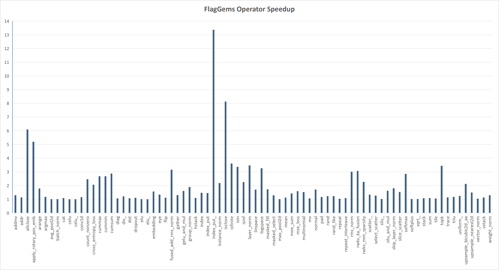

<!--
 Copyright 2026 FlagOS Contributors

 Licensed under the Apache License, Version 2.0 (the "License");
 you may not use this file except in compliance with the License.
 You may obtain a copy of the License at

     http://www.apache.org/licenses/LICENSE-2.0

 Unless required by applicable law or agreed to in writing, software
 distributed under the License is distributed on an "AS IS" BASIS,
 WITHOUT WARRANTIES OR CONDITIONS OF ANY KIND, either express or implied.
 See the License for the specific language governing permissions and
 limitations under the License.
 -->

# 性能基准评测概览

与 PyTorch 原生 ATen 算子库相比，*FlagGems* 算子在大多数典型业务负载下均能提供超越原生的性能优势，在通用基准算子上亦能做到性能完全媲美或持平。
我们统一采用 Triton 官方评测框架 `triton.testing.do_bench` 进行严格的端到端耗时与吞吐测试。各典型算子的加速比如下图所示：

> [!NOTE]
> 上图展示了在 Eager 模式下，*FlagGems* 相较 PyTorch ATen 原生实现的综合加速比。该数值通过在多种生产级典型 Shape（涵盖长上下文、大 Batch 等场景）下测得的加速比取平均计算得出，直观反映了算子的总体性能表现。

为了保证算子库的性能质量，社区要求**所有新增或重构的算子均必须补充完整的基准测试用例与实测性能数据**。

关于如何为新算子编写性能评测脚本并纳入基准测试流水线，请参阅[算子性能基准测试指南](benchmark.md)。
